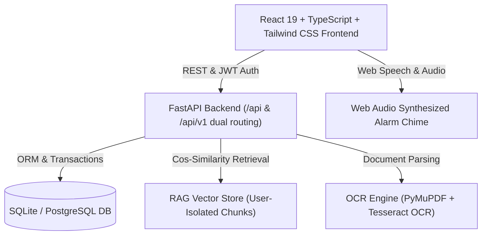

# MEDINOVA-AI — Your Intelligent Personal Health Copilot

> **"Your Health. Your AI Companion."**  
> A full-stack, clinical-grade, AI-powered healthcare web application engineered with FastAPI, SQLAlchemy, SQLite/PostgreSQL, React, TypeScript, and Tailwind CSS.

---

## 🌟 Overview & Key Capabilities

**MEDINOVA-AI** bridges the gap between complex clinical documentation and patient understanding. It acts as an intelligent, empathetic health copilot that parses medical prescriptions and lab reports, tracks medication schedules, delivers real-time audio alarms, monitors adherence analytics, facilitates conflict-free doctor consultations, and enables conversational AI and multilingual voice consultations.

### Primary Pillars
1. **Prescription Scanner & Extraction**: Advanced OCR (PyMuPDF + Tesseract) extracts medicine names, strength, dosage, route, frequency, meal timing, and refill limits with editable human confirmation.
2. **Laboratory Document Scanner & Analyzer**: Automatically parses diagnostic reports, flags abnormal values against clinical reference ranges, and renders clear, structured findings.
3. **Grounded AI Health Assistant (MEDINOVA Chat)**: Tenant-isolated RAG vector search over patient documents to answer questions with citations, refusing ungrounded advice.
4. **Multilingual Voice Assistant**: Speech-to-text and voice synthesis supporting **English, Telugu, Hindi, Tamil, and Kannada** via Web Speech API.
5. **My Medicines & Daily Regimen Timeline**: Complete medication schedule management with visual morning/afternoon/evening breakdowns and remaining-dose tracking.
6. **Web Audio Reminder Alarms**: Synthesized dual-frequency chime alarm system (`440Hz` -> `880Hz` harmonic sweep) triggering responsive alert modals.
7. **Adherence Analytics**: Clinically compliant formula tracking taken vs. scheduled doses across 7-day, 30-day, and monthly horizons.
8. **Doctor Discovery & Telehealth Booking**: Conflict-prevented appointment reservations, specialist filtering, and profile insights.
9. **Medical Vault & Document Library**: Encrypted document archiving with category tags, preview modals, and exportable clinical summaries.
10. **Emergency Helplines & Safety Guard**: Integrated emergency dialing protocols (`112`, `108`, `1075`), DPDP guidelines, and persistent non-diagnostic disclaimers.

---

## 🏛 System Architecture



---

## 🚀 Quick Start Guide

### Prerequisites
- **Node.js** (v18+) & **npm**
- **Python** (v3.11+)
- *(Optional)* **Tesseract OCR** (Pre-configured at `C:\Program Files\Tesseract-OCR\tesseract.exe`)

---

### 1. Backend Setup

```bash
cd backend

# Activate virtual environment
# Windows:
venv\Scripts\activate
# Linux/macOS:
source venv/bin/activate

# Install dependencies
pip install -r requirements.txt

# Initialize & Seed Database with Demo Clinicians and Patient Data
python app/db/seed.py

# Launch FastAPI Server (runs on http://127.0.0.1:8000)
uvicorn app.main:app --host 127.0.0.1 --port 8000 --reload
```

Interactive Swagger API Documentation:  
🔗 **[http://127.0.0.1:8000/docs](http://127.0.0.1:8000/docs)**

---

### 2. Frontend Setup

```bash
cd frontend

# Install npm packages
npm install

# Start Vite Development Server (runs on http://localhost:5173)
npm run dev

# Or build for production
npm run build
```

---

## 🔑 Demo Login Credentials

The database comes pre-seeded with a comprehensive demo profile:

| Field | Credentials |
| :--- | :--- |
| **Email** | `demo@medinova.ai` |
| **Password** | `Medinova2026!` |
| **Role** | Patient (Ravi Kumar) |
| **Pre-loaded Regimens** | Metformin 500mg, Atorvastatin 20mg |
| **Pre-loaded Report** | Complete Metabolic Panel (Glucose 142 mg/dL, HbA1c 7.1%) |
| **Pre-loaded Appointment** | Dr. Ananya Sharma (Cardiologist, Apollo Health City) |

---

## 📋 Comprehensive Views & Tabs

MEDINOVA-AI features 23 functional views accessible via the responsive navy sidebar and contextual links:

| View Name | Tab ID | Description |
| :--- | :--- | :--- |
| **Main Dashboard** | `dashboard` | Circular adherence ring, next dose countdown, cardiac vitals, action quick-launch |
| **Prescription Scanner** | `prescription-scanner` | Upload prescriptions, OCR text parsing, confidence check, confirm medicines |
| **Document Scanner** | `documents` | Drag & drop medical files, PDF/image inspection, RAG vector embedding |
| **Document Library** | `document-library` | Secure vault archive, filter by type, detail preview modal, export summary |
| **Report Analyzer** | `report-analyzer` | Structured lab extraction table, normal/abnormal flags, doctor questions |
| **AI Health Assistant** | `ai-assistant` | Contextual RAG chatbot with citations and grounded clinical disclaimers |
| **Multilingual Voice Assistant**| `voice-assistant` | Voice interactions in English, Telugu, Hindi, Tamil, and Kannada |
| **My Medicines** | `medicines` | Active medication list, quick add, archive action, frequency instructions |
| **Daily Schedule** | `medicine-schedule` | Morning/Afternoon/Evening dose timeline, take/skip action, test alarm |
| **Detailed Regimen Editor** | `add-medicine` | Comprehensive form for doses, routes, meal timing, and clinical precautions |
| **Adherence Analytics** | `adherence` | Documented compliance formula, 7-day adherence bar chart, dose log history |
| **Health Insights** | `health-insights` | Metabolic trends (glucose, cholesterol) with Recharts visual graphs |
| **Doctor Discovery** | `doctors` | Specialty filter, physician rating, consultation fees, slot booking modal |
| **Doctor Profile** | `doctor-profile` | Physician bio, hospital affiliation, language fluency, direct slot reserve |
| **Appointments** | `appointments` | View upcoming and past appointments, cancel, reschedule with conflict checks |
| **Health Timeline** | `health-timeline` | Chronological history of lab tests, prescriptions, and logged appointments |
| **Notification Center** | `notifications` | Notification feed, reminder alarm test, sound alerts configuration |
| **Emergency & Safety** | `help-disclaimer` | Indian national helplines (112, 108, 1075), DPDP privacy compliance notice |
| **User Profile** | `profile` | Medical history, allergies, emergency contacts, language & timezone options |
| **System Settings** | `settings` | Audio alert preferences, security tokens, data privacy management |
| **Landing Page** | N/A | Futuristic clinical landing page with feature showcase and quick login |
| **Sign In** | N/A | Secure email/password login with session preservation |
| **Sign Up** | N/A | New patient onboarding with health profile initialization |

---

## 🧪 Automated Test Suite

The backend includes a comprehensive 10-point test suite validating critical healthcare workflows:

```bash
cd backend
venv\Scripts\python.exe -m pytest tests/test_full_suite.py -v
```

### Verified Test Matrix:
- ✅ `test_auth_registration_and_login`: JWT generation, password hashing, user session validation.
- ✅ `test_document_upload_and_rag_indexing`: Document parsing and vector embedding.
- ✅ `test_cross_user_rag_isolation`: Strict tenant isolation ensuring zero data cross-leakage between users.
- ✅ `test_prescription_extraction_and_confirmation`: OCR pipeline and human-in-the-loop medicine saving.
- ✅ `test_medication_adherence_calculation`: Mathematical compliance formula verification.
- ✅ `test_doctor_appointment_booking_and_conflict`: Anti-double-booking validation.
- ✅ `test_dashboard_summary_and_adherence`: Real-time aggregated dashboard payload.
- ✅ `test_password_reset_flow`: Forgot-password token issuance and password reset verification.
- ✅ `test_doctor_profile_and_reschedule`: Doctor availability querying and appointment rescheduling.
- ✅ `test_notification_preferences`: Notification preference retrieval and updates.

---

## 🛡 Security, Safety & Legal Guardrails

1. **Non-Diagnostic Notice**: The assistant explicitly states it is an educational copilot, never diagnosing conditions or modifying prescribed dosages without clinician consultation.
2. **Tenant Isolation**: Every database query and vector retrieval operation requires the authenticated `user_id`. One patient cannot retrieve another patient's documents or reminders.
3. **Emergency Escalation**: When potential emergency symptoms are identified, the system immediately recommends contacting local emergency helplines (`112` / `108`).
4. **Data Privacy**: Built adhering to Digital Personal Data Protection (DPDP) and HIPAA data segregation principles.

---

## 📄 License
Licensed under the Apache-2.0 License.
